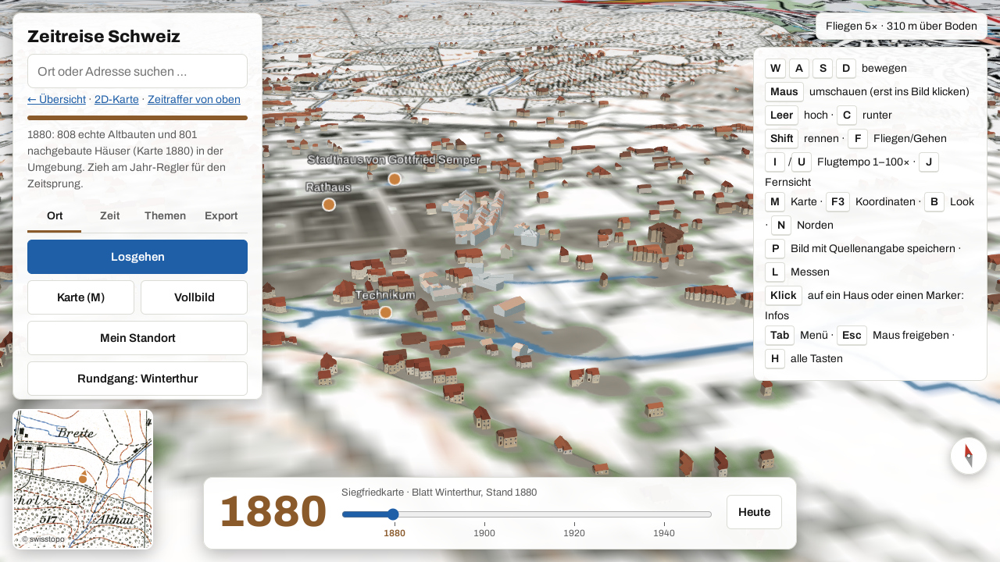
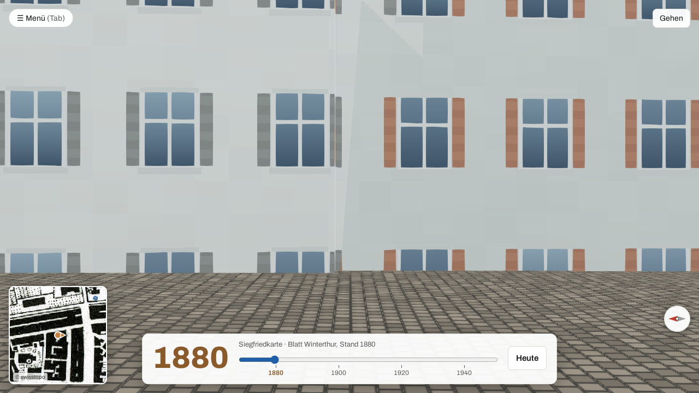
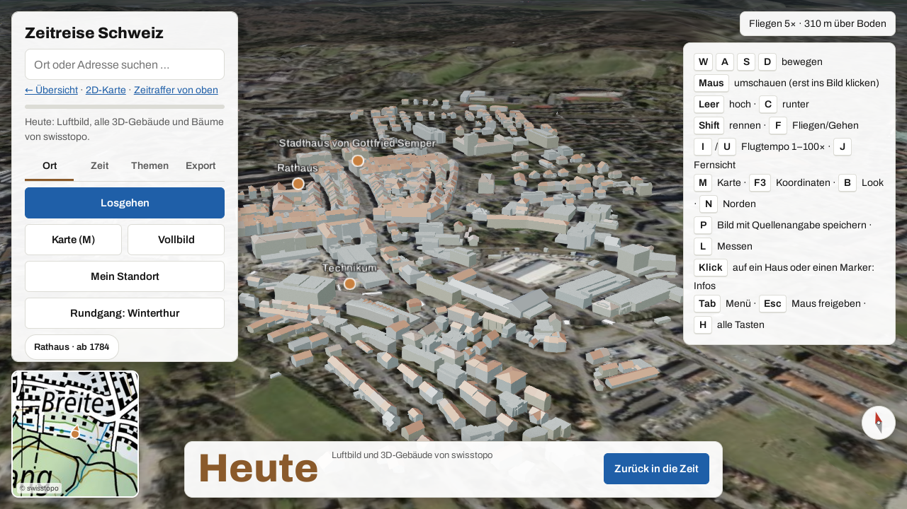
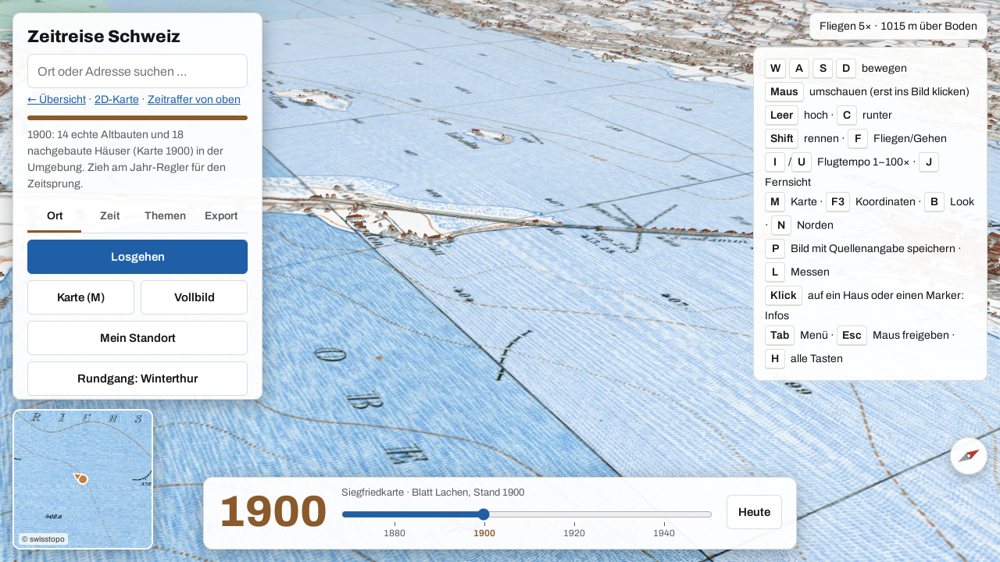
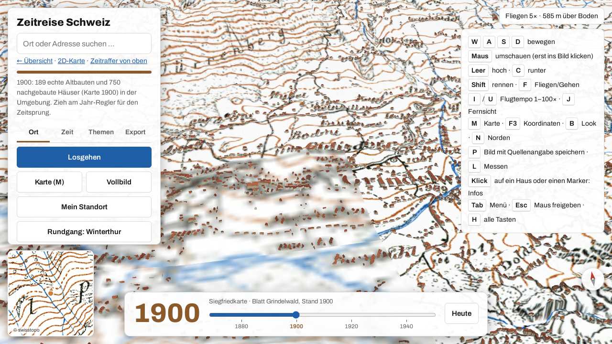
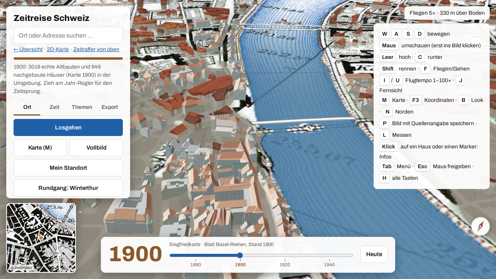
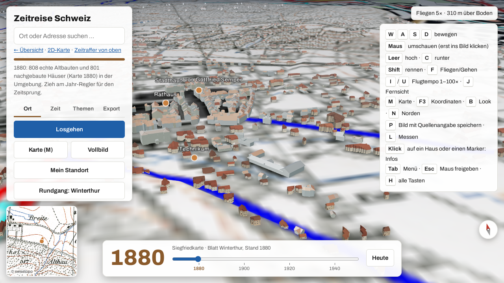
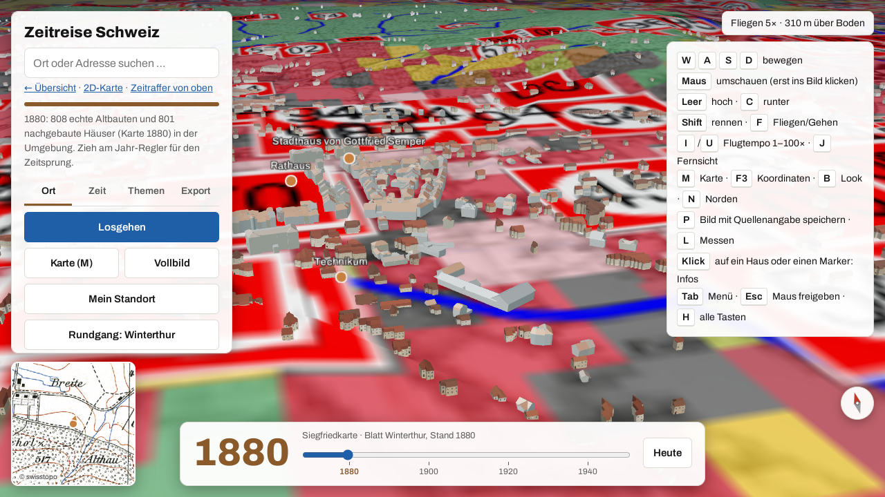
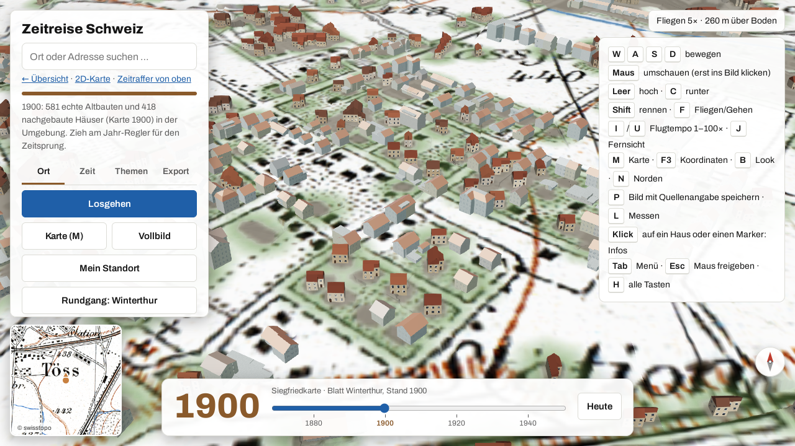

# Bildtest 3D-Flug

Software-Grafik (SwiftShader): Bilder pro Sekunde sind viel tiefer als auf einem echten Gerät, taugen aber zum Vergleich.

## 1-winterthur-oben-1880

- 61 s bis fertig, 0.7 Bilder/s
- Anzeige: Fliegen 5× · 310 m über Boden
- Karte: Siegfriedkarte · Blatt Winterthur, Stand 1880
- Status: 1880: 808 echte Altbauten und 801 nachgebaute Häuser (Karte 1880) in der Umgebung. Zieh am Jahr-Regler für den Zeitsprung.
- Meldungen: 0

## 2-winterthur-gasse-1880

- 70 s bis fertig, 0.2 Bilder/s
- Anzeige: Gehen
- Karte: Siegfriedkarte · Blatt Winterthur, Stand 1880
- Status: 1880: 860 echte Altbauten und 726 nachgebaute Häuser (Karte 1880) in der Umgebung. Zieh am Jahr-Regler für den Zeitsprung.
- Meldungen: 0

## 3-winterthur-heute

- 50 s bis fertig, 1.2 Bilder/s
- Anzeige: Fliegen 5× · 310 m über Boden
- Karte: Luftbild und 3D-Gebäude von swisstopo
- Status: Heute: Luftbild, alle 3D-Gebäude und Bäume von swisstopo.
- Meldungen: 0

## 4-zuerichsee-rapperswil-1900

- 71 s bis fertig, 0.2 Bilder/s
- Anzeige: Fliegen 5× · 1015 m über Boden
- Karte: Siegfriedkarte · Blatt Lachen, Stand 1900
- Status: 1900: 14 echte Altbauten und 18 nachgebaute Häuser (Karte 1900) in der Umgebung. Zieh am Jahr-Regler für den Zeitsprung.
- Meldungen: 0

## 5-bergdorf-grindelwald-1900

- 65 s bis fertig, 0.1 Bilder/s
- Anzeige: Fliegen 5× · 585 m über Boden
- Karte: Siegfriedkarte · Blatt Grindelwald, Stand 1900
- Status: 1900: 189 echte Altbauten und 750 nachgebaute Häuser (Karte 1900) in der Umgebung. Zieh am Jahr-Regler für den Zeitsprung.
- Meldungen: 0

## 6-basel-rheinbruecke-1900

- 64 s bis fertig, 0.4 Bilder/s
- Anzeige: Fliegen 5× · 330 m über Boden
- Karte: Siegfriedkarte · Blatt Basel-Riehen, Stand 1900
- Status: 1900: 3019 echte Altbauten und 949 nachgebaute Häuser (Karte 1900) in der Umgebung. Zieh am Jahr-Regler für den Zeitsprung.
- Meldungen: 0

## 7-winterthur-themen-isos-ivs

- 51 s bis fertig, 1 Bilder/s
- Anzeige: Fliegen 5× · 310 m über Boden
- Karte: Siegfriedkarte · Blatt Winterthur, Stand 1880
- Status: 1880: 808 echte Altbauten und 801 nachgebaute Häuser (Karte 1880) in der Umgebung. Zieh am Jahr-Regler für den Zeitsprung.
- Meldungen: 0

## 8-winterthur-themen-luftbild-areal-gewaesser

- 51 s bis fertig, 0.9 Bilder/s
- Anzeige: Fliegen 5× · 310 m über Boden
- Karte: Siegfriedkarte · Blatt Winterthur, Stand 1880
- Status: 1880: 808 echte Altbauten und 801 nachgebaute Häuser (Karte 1880) in der Umgebung. Zieh am Jahr-Regler für den Zeitsprung.
- Meldungen: 0

## 9-toessbruecke-1900

- 56 s bis fertig, 0.5 Bilder/s
- Anzeige: Fliegen 5× · 260 m über Boden
- Karte: Siegfriedkarte · Blatt Winterthur, Stand 1900
- Status: 1900: 581 echte Altbauten und 418 nachgebaute Häuser (Karte 1900) in der Umgebung. Zieh am Jahr-Regler für den Zeitsprung.
- Meldungen: 0

